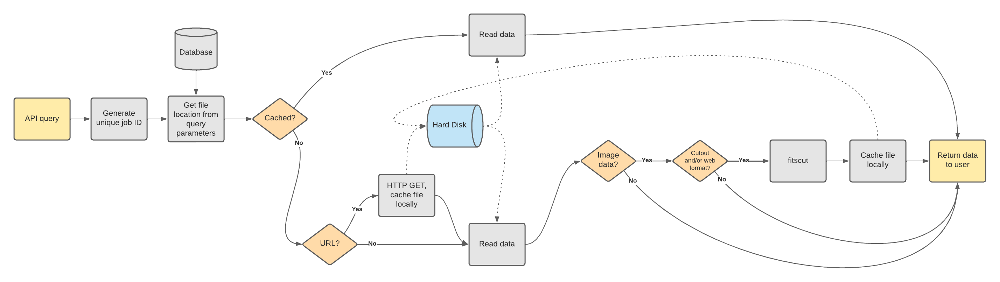

# SBN Survey Image Service

## What is This?

The SBN Survey Image Service is a REST API that enables a user to retrieve archive images and cutouts thereof from the Planetary Data System's Small-Bodies Node (PDS SBN). For example, a user may request a full-frame image from the ATLAS survey archive, or a small cutout around their object of interest. The returned data may be in FITS, JPEG, or PNG formats. The service can also return the image's PDS label.



The [SBN Survey Image Service](https://sbnsurveys.astro.umd.edu/api/ui) (SIS) is deployed and available for [PDS Small-Bodies Node](https://pds-smallbodies.astro.umd.edu/) survey holdings. See the [API User’s Guide](https://sbn-survey-image-service.readthedocs.io/en/latest/api-guide.html) or the [API documentation](https://sbnsurveys.astro.umd.edu/api/ui) for details.

## Code Features

- Flask API layer
- OpenAPI spec with Connexion and Swagger
- Gunicorn for production deployment
- Backed by Postgresql or Sqlite3

## Documentation

### North-up previews

JPEG/PNG requests with `align=true` render an ICRS TAN grid with north up and
east left. The rendered image keeps the native dimensions and pixel scales,
is centered on the native array center, and embeds its output WCS as AVM.
FITS data remain native. Cache identity includes `north-up-v1` and alignment,
including full-frame requests, to avoid reusing older browse geometry.

`GET /previews/skymapper?image=...&ra=...&dec=...&size=...` takes SkyMapper DR4
IMAGE and POS/SIZE (size in degrees, less than 10 arcmin). It reads the exact
matching FITS header in HTTP 206 byte ranges, never falls back to a full FITS,
reverses the documented PA=0/180 PNG transform, and renders a cached PNG with
AVM using the full TPV WCS. Unknown transforms and mismatched dimensions fail.

`GET /previews/panstarrs?image=...&ra=...&dec=...&size=...` takes a single-band
PS1 rings.v3.skycell path and the same native cutout size as its FITS URL.
PS1 does not honor Range for generated cutouts; this adapter reads its bounded
header stream and closes it at END before reading scientific pixels. It then
normalizes the matching PNG. PS1 may still generate the entire cutout upstream.

Both adapters use fixed upstream endpoints, bound headers to 92,160 bytes,
PNGs to 8 MiB and dimensions to 2048 pixels, and publish atomically to the
existing cutout cache. Deploy these routes before the new CATCH GUI. The GUI
shares their requests with the two-request UMD capacity limit and uses its
same-origin Express proxy to avoid CORS and mixed-content issues.

For a local preview API without deployment configuration or a catalogue DB:

```bash
./_develop_previews
```

The runner binds only to `127.0.0.1:5010`. It uses the real renderer/adapters
and an automatically cleaned temporary cache. It accepts `/previews/skymapper`,
`/previews/panstarrs`, and `/images/owned?url=<encoded existing cutout URL>`.
Owned previews use an on-demand FITS download from the existing UMD/AWS cutout
service; the local API renders and caches the preview and serves the unchanged
science bytes. It does not exercise the production catalogue database. Native
downloads are limited to 64 MiB and image arrays to 2048 by 2048 pixels.

`uv` supplies `requirements.preview.txt`; an already configured Python can be
selected with `CATCH_PREVIEW_PYTHON`. For the GUI and renderer together, use
`npm run dev:images` in the sibling GUI checkout. No mock search data changes
are needed. `--cache-dir` lets a caller own cache cleanup; without it, the
runner owns a temporary directory that is removed when the process exits.

The isolated tests do not initialize the application's configuration:

```bash
python -m pytest tests/test_orientation.py tests/test_local_preview.py
```

Documentation is provided in the ``/docs`` directory, and at [readthedocs](https://sbn-survey-image-service.readthedocs.io).
